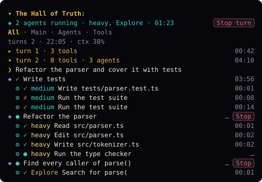

# Eyes of Horus

A Claude Code mod that dresses the desktop app and the terminal in gold and obsidian, and shows what Claude and its agents are doing as Egyptian gods at work.


The pictures in this README are drawn by the mod's own drawing code from made-up sample data (see [Develop](#develop)). They are not screenshots.

## What you get

### The eye

An ASCII Eye of Horus sits centred under the latest reply. It glances around, blinks, follows the pointer while the pointer is over it, and narrows while a tool runs. With voice-over on (`/voiceover on`), an orb with subtitles reads replies aloud.

### The dashboard band

A band above the prompt holds ponytail level buttons, a context bar, cost, token, agent-time and turn counts, the savvy-flow progress bar, and a heartbeat trace that speeds up while Claude works. The ponytail buttons need the [ponytail](#optional-extras) plugin; the progress bar needs savvy-flow.

### The Gods pane



A side pane with a card for each agent. A savvy-flow agent is drawn as a god by its tier; any other agent is a worker whose tool depends on its type. Each card shows the task, the tier and model, a ticking clock, the agent's own step bar and its token count. Running and Finished groups fold on their own. `/clear` empties the cards, the log and the counts.



| Tier | God |
| --- | --- |
| `savvy-fable` | Ra |
| `savvy-heavy` | Anubis |
| `savvy-careful` | Horus |
| `savvy-medium` | Thoth |
| `savvy-light` | Bastet |

### The Hall of Truth



The session log, at the bottom of the Gods pane, grouped by turn:

- a Now line says what runs at the moment, with its clock;
- filter chips show All, Main, Agents or Tools;
- each turn header shows its tool and agent counts and how long it took;
- every entry (the newest 400) is listed; the pane scrolls;
- Stop turn on the Now line and Stop on each running agent's row each need two clicks: the first turns the button into "Sure?", the second stops, and it resets after 3 seconds;
- clicking an agent's row opens its chamber in the Temple.

When an agent finishes or fails, a short toast says so.

### The Temple



A second pane, opened with `/temple` or the ↗ on a Gods card. Idle gods and workers stand in a columned hall; an agent that just finished celebrates there for a few seconds.



Each working agent gets a chamber: its animated figure, progress bar, running clock, token count and its last few actions. The ↗ on a chamber opens the focus view: that one agent, its longer action list, the start of its final report once it ends, and Back, Transcript (terminal only) and a two-click Stop.

### Animations

Figures walk, work, breathe, blink and celebrate, each in its own rhythm. The animations ignore the operating system's reduced-motion setting on purpose, so they play even with system animations turned off. `/horus-motion off` turns them off for the mod; `/horus-motion on` turns them back on.

## Install the mod only

From a shell:

```
claude plugin marketplace add nzjealousy/eyes-of-horus
claude plugin install eyes-of-horus@eyes-of-horus
```

Then run `/reload-plugins` in a session (or start a new one) and `/horus-doctor` to check it.

In the desktop app, where `/plugin` does not run: click + next to the prompt box, then Plugins, Add marketplace with `nzjealousy/eyes-of-horus`, then add the `eyes-of-horus` plugin.

## Install the whole kit

`horus-kit` installs the mod together with the savvy-flow workflow and adds a setup command. Add the `claude-kit` marketplace first, because savvy-flow and savvy-progress come from it:

```
claude plugin marketplace add https://github.com/JohnnyVizz/claude-kit.git
claude plugin marketplace add nzjealousy/eyes-of-horus
claude plugin install horus-kit@eyes-of-horus
```

Then run `/reload-plugins` and `/horus-kit:setup`. The setup:

1. checks that `eyes-of-horus`, `savvy-flow` and `savvy-progress` are installed and prints the install commands for any that are missing (it runs none);
2. lists the optional extras below;
3. copies a notes-vault memory (an ICARUS index, global rules, agent notes and a project template) into a folder you choose;
4. offers to append matching working rules to `~/.claude/CLAUDE.md`.

It asks before every write, skips existing files unless you say otherwise, and never installs plugins or changes settings itself.

## Commands

| Command | What it does |
| --- | --- |
| `/voiceover [on\|off\|test]` | Voice-over on or off, or speak one test line. |
| `/horus-eye` | Says what the eye is doing and the last drawing fault, if any. |
| `/horus-doctor` | One line per part: surfaces, panes, the ponytail flag, motion, stored counts, and whether a plugin can call TaskStop (a harmless probe). |
| `/temple` | Opens the Temple pane. |
| `/horus-motion [on\|off]` | The mod's animations on or off; no argument toggles. On by default. |
| `/horus-kit:setup` | The kit's guided setup (horus-kit only). |

## Optional extras

None of these is needed. Add the marketplace, then install the plugin from it (`claude plugin marketplace list` or the `/plugin` browser shows its name):

```
claude plugin marketplace add DietrichGebert/ponytail                       # ponytail: lazy senior dev mode
claude plugin marketplace add hellosverre/claude-skins                      # skins: transcript skins
claude plugin marketplace add karanb192/claude-code-mods                    # cache-tax: prompt-cache cost mod
claude plugin marketplace add gamedev-skills/awesome-gamedev-agent-skills   # gamedev: game development skills
```

The dashboard's ponytail level buttons run ponytail's own command, so they need ponytail installed.

## Credits

- savvy-flow and savvy-progress are part of [JohnnyVizz's claude-kit](https://github.com/JohnnyVizz/claude-kit).
- ponytail is [DietrichGebert's](https://github.com/DietrichGebert/ponytail).

horus-kit only references these plugins; it does not copy their code.

## Limits

- The desktop sidebar can only be tinted, and the prompt box cannot be replaced.
- The desktop app has no transcript view a plugin can open, so Transcript in the Temple works in the terminal only.
- A single running tool call cannot be stopped on its own; Stop turn stops the whole turn.
- Voice-over needs a system speech synthesizer; without one it shows subtitles only.
- The eye follows the pointer only while the pointer is over it.
- Animations ignore the system reduced-motion setting by design; use `/horus-motion off`.
- Tested on desktop app 4.23118 with engine 2.1.317. Since then the mod also tries the newer `$.theme.set` backdrop call first (engine 2.1.319 removed `$.ui.backdrop`); the Temple and the always-on animations have not yet been checked in the real app.

## Privacy and safety

- No network calls and no shell commands.
- The only file it reads is ponytail's flag file (`.ponytail-active`) in your Claude config folder.
- Log labels are cleaned of control characters, and credentials (`token=`, `Bearer ...`, `user:pass@`) are masked. The log shows a tool's name and description only for shell tools.
- The log for a session is saved in the app's plugin store: the newest 100 entries, for the last 5 sessions, so `claude --resume` brings it back.
- Every savvy-flow agent (`savvy-*`) gets a short "terse answers" line added to its prompt. Other agents' prompts are left alone.

## Develop

From the folder that holds this repo (named `eyes-of-horus`):

```
claude plugin test eyes-of-horus
claude plugin validate eyes-of-horus
```

The README pictures come from `docs/make-previews.mjs`, which imports the real drawing code with a stand-in for the engine module. From the repo root, with [Deno](https://deno.com):

```
deno run --config docs/previews.json --sloppy-imports --allow-read --allow-write=docs/img docs/make-previews.mjs
```

It writes the SVGs to `docs/img/`. The sample data in it is made up.

## License

MIT
